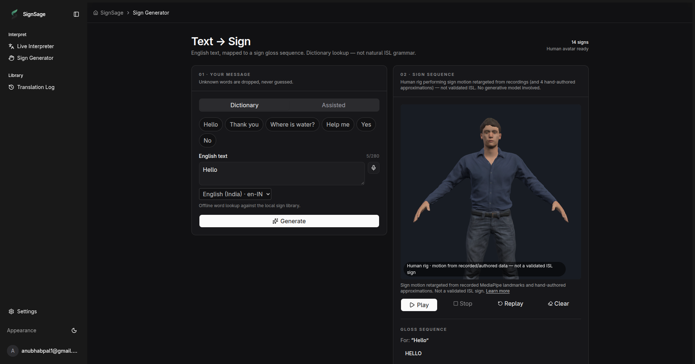
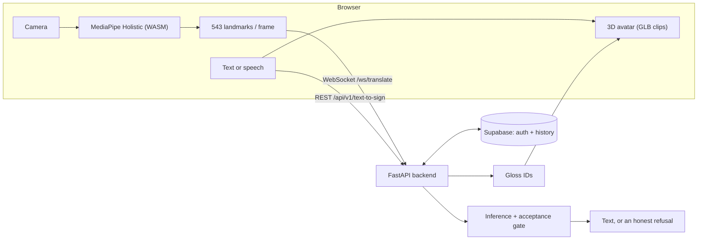

# SignSage

**A bidirectional Indian Sign Language (ISL) ↔ English web application.**
Sign into your camera and read English; type or speak English and watch a 3D avatar sign it.

> **Privacy by design:** on the live camera path, raw video never leaves your browser; only landmark coordinates are sent to the backend. An optional *upload a video* feature sends the file you choose (see [SECURITY.md](SECURITY.md)).



## Project status

SignSage started as an M.Tech research prototype and is being turned into a real, user-facing product. The rule that does not change: **the app never presents an unvalidated result as a translation.**

| Capability | Status | Notes |
|---|---|---|
| Browser camera → MediaPipe Holistic → 543 landmarks/frame → WebSocket → backend | Implemented | Landmarks only; ~10 fps |
| Static alphabet recognition (A–Z images) | Verified | ~87% held-out accuracy; weak on W, Z, S |
| Isolated ISL word recognition (`word_v3`) | Experimental, **not promoted** | 9 words, one signer |
| Full-vocabulary ISL recognition (FDMSE-ISL, 2,002 words) | Offline baseline trained, **not integrated or promoted** | Test split (8 unseen signers): 82.1% top-1, 95.1% top-5 on studio video; webcam accuracy not yet measured; see [MODELS_AND_DATA](docs/MODELS_AND_DATA.md) |
| English → ISL (text/speech → gloss → 3D avatar) | Implemented, bounded | 14 gloss IDs; unknown words are dropped, never guessed; motion not yet validated by a fluent signer |
| Sign → sentence composition | Implemented | Rule-based, then a constrained LLM; it can never add content words |
| Text-to-speech | Implemented | Server provider when configured, browser Web Speech fallback |
| Accounts and history | Implemented, optional | Supabase auth + per-user row-level security; signed-out mode works |
| Open-vocabulary sentence-level Sign → Text | **Not available** | The old transformer collapsed in evaluation; the promotion gate stays closed |

`SIGNSAGE_MODEL_PROMOTED=false` — `/api/v1/capabilities` reports model state honestly. Details: [PRD](docs/PRD.md) and [MODELS_AND_DATA](docs/MODELS_AND_DATA.md).

SignSage is not a certified interpreter and must not be used for medical, legal, emergency or other high-stakes communication.

## How it works



Full design: [docs/ARCHITECTURE.md](docs/ARCHITECTURE.md).

## Tech stack

| Layer | Stack |
|---|---|
| Frontend | React 19, TypeScript, Vite, Tailwind 4, shadcn/ui, Three.js (avatar) |
| Backend | FastAPI, PyTorch, MediaPipe |
| Auth / history | Supabase (Postgres, JWT, row-level security) |
| Speech | Browser Web Speech; optional server TTS/STT providers |
| Hosting | Vercel (frontend), Render (backend) |

## Repository layout

```text
signsage/
├── frontend/     React + Vite app (camera capture, WebSocket client, avatar)
├── backend/      FastAPI inference server (adapters, routes, auth, history)
├── research/     Training notebooks, experiments, evaluation artifacts (never serving code)
├── models/       Model metadata (weights are gitignored and fetched at runtime)
├── data/         Dataset manifests; local signer reference clips (data/videos/ is gitignored)
├── docs/         Project documentation (start at docs/README.md)
└── render.yaml   Render blueprint for the backend and its model disk
```

Never committed: `.env` files, API keys and tokens, dataset archives and videos, model weights (`*.pt`, `*.pth`), `node_modules/`, `.venv/`.

## Getting started

**Backend**

```bash
cd backend
python3 -m venv .venv && source .venv/bin/activate
pip install -r requirements.txt
cp .env.example .env              # defaults work for a local demo
uvicorn app.main:app --reload     # http://127.0.0.1:8000  (Swagger at /docs)
```

**Frontend**

```bash
cd frontend
npm install
cp .env.example .env.local        # only to change backend URLs or enable Supabase
npm run dev                       # http://127.0.0.1:5173
```

**Tests**

```bash
cd backend && pytest              # backend suite
cd frontend && npm test           # frontend unit tests
```

More: [CONTRIBUTING.md](CONTRIBUTING.md), [docs/TESTING.md](docs/TESTING.md), [docs/DEPLOYMENT.md](docs/DEPLOYMENT.md).

## Documentation

| Read | For |
|---|---|
| [docs/PRD.md](docs/PRD.md) | What we are building, for whom, scope, requirements, roadmap |
| [docs/ARCHITECTURE.md](docs/ARCHITECTURE.md) | System design, contracts, API, decisions |
| [docs/MODELS_AND_DATA.md](docs/MODELS_AND_DATA.md) | Datasets, models, evaluation, promotion gates, training pipeline |
| [docs/DESIGN_SYSTEM.md](docs/DESIGN_SYSTEM.md) | UI principles, tokens, components, honesty patterns |
| [docs/CODE_STYLE.md](docs/CODE_STYLE.md) · [docs/TESTING.md](docs/TESTING.md) | Conventions and test strategy |
| [docs/DEPLOYMENT.md](docs/DEPLOYMENT.md) | Vercel, Render, Supabase, model bundles |
| [docs/SIGN_ANIMATION.md](docs/SIGN_ANIMATION.md) | How avatar sign motion is produced |
| [SECURITY.md](SECURITY.md) | Reporting a vulnerability, privacy and secrets rules |
| [AGENTS.md](AGENTS.md) | Rules for AI coding agents |
| [CHANGELOG.md](CHANGELOG.md) · [CREDITS.md](CREDITS.md) | History; people, datasets and third-party licenses |

If a document and the code disagree, the code wins — please open an issue.

## Credits

SignSage builds on an earlier ASL ↔ English prototype (V1) by
[Anwesa Sinha](https://www.linkedin.com/in/anwesa-sinha/),
[Draksha](https://www.linkedin.com/in/draksha-aa3164227/),
[Satyaki Dawn](https://www.linkedin.com/in/satyaki-dawn-116420230/) and
[Subhadip Das](https://www.linkedin.com/in/subhadip-das-7a150319b/).
The current ISL version is a re-implementation and extension of that work.

ISL recognition research uses the **FDMSE-ISL** dataset, used with the authors' permission. Please cite:

> Patra, S., Maitra, A., Tiwari, M., Kumaran, K., Prabhu, S., Punyeshwarananda, S., Samanta, S. *Hierarchical Windowed Graph Attention Transformer Encoder and a Large Scale Dataset for Indian Sign Language Recognition.* Pattern Analysis and Applications 28(3):148, 2025. doi:10.1007/S10044-025-01529-3

Full list of datasets, libraries and licenses: [CREDITS.md](CREDITS.md).

## License

Code: MIT — see [LICENSE](LICENSE). Datasets and model weights carry their own terms and do **not** inherit the MIT license; see [CREDITS.md](CREDITS.md).
