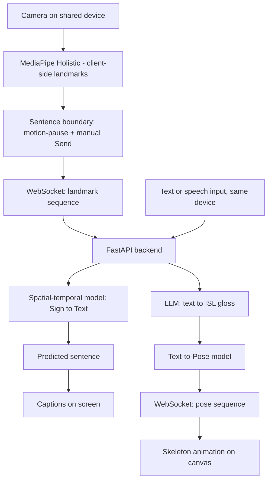

# SignSage — Architecture

## Current state (be honest about this)

As of this writing: **no standalone backend or frontend exists**, and per AGENTS.md's
core rule, none should until Phase 0.5 (module extraction) is underway. That part hasn't
changed. What has changed: the primary artifact, `research/notebooks/signsage.ipynb` (61 cells),
has now been **run end-to-end on real iSign data on Kaggle, twice** — a bounded
2,000/300/300-row validation pass, then a scaled-up 10,000/1,500/1,500-row pass. Both
completed without errors. Do not read "ran without errors" as "produced a working
model," though — see `research/outputs/phase0/RESULTS.md` for the actual findings.
Concretely: the Sign→Text models currently mode-collapse to a small number of repeated
phrases, and the Text→Pose model currently collapses to a near-static average pose. The
pipeline is validated; the model quality is not, and two specific root causes (decoding
strategy, pose loss function) have been identified for whoever picks this back up.

The earlier Phase-1/2 live-demo prototype (a FastAPI WebSocket server plus a MediaPipe
HTML/JS client, formerly Section 18 behind `RUN_LIVE_DEMO = False`) has been **removed
from the notebook entirely** — the research artifact no longer contains serving code. See
DECISIONS.md for why, and API.md / DESIGN.md for a record of how that spike diverged from
the contract, kept so the real backend doesn't repeat the same mistakes. Everything below
is the target MVP architecture, gated on the notebook producing a go decision (see
PHASES.md — that decision now exists, `GO-CANDIDATE`, with the caveats above). Do not
start building the standalone version until Phase 0.5 has extracted the shared
normalization/model code out of the notebook.

## Training-time architecture (what actually runs today)

```text
HuggingFace: Exploration-Lab/iSign (gated, CC BY-NC-SA 4.0)
  ├── iSign_v1.1.csv                      downloaded outright (9.81 MB)
  └── iSign-poses_v1.1_part_a{a,b,c,d}    NOT downloaded; opened as one virtual
                                          ZIP64 over HTTP range requests
        ↓
Kaggle Notebook (GPU T4, Internet enabled, HF_TOKEN secret)
  ├── lazy per-member .pose fetch  →  /kaggle/temp/signsage_cache/  (ephemeral)
  ├── preprocessing, normalization, face ablation
  ├── training (GRU, Transformer, pose generator)
  ├── evaluation (WER/BLEU/ROUGE-L, DTW, motion-energy check, round-trip, latency)
  └── /kaggle/working/signsage_outputs/
        ├── checkpoints/
        ├── reports/
        ├── signsage_knowledge.db
        └── signsage_knowledge_manifest.json
        ↓
downloaded into this repo (research/outputs/phase0/)  →  Phase 1 backend loads the checkpoint for inference
```

Confirmed by two completed runs, not just designed: this streaming path reliably fetches
only the pose members a given `TRAIN_LIMIT`/`VAL_LIMIT`/`TEST_LIMIT` selection needs, at
both a 2,300-unique-row scale and a 13,000-unique-row scale, without extracting or
uploading the archive. Wall-clock is dominated by this remote fetch (~0.7s per unique
UID observed), not by GPU compute, at these model sizes.

The application never retrains. Training is a separate, offline, expensive step; the
backend loads a finished checkpoint and reads the knowledge repository only for
model/experiment metadata.

## Why single-device, not two-device relay

The original proposal's diagram shows Person A and Person B as separate clients relayed
through a FastAPI backend over WebSocket, with short-lived room codes for pairing. That
is a **deferred, post-MVP feature**, not the starting point, because:

- The primary use case (a Deaf person and a hearing person communicating without an
  interpreter) is overwhelmingly a same-room scenario — a reception desk, a classroom, a
  clinic. Think "Google Translate conversation mode passed between two people," not
  "two phones on a video call."
- A two-device relay adds session management, room-code generation/expiry, WebSocket
  reconnect handling, and NAT/deployment concerns — none of which test whether the
  underlying translation is any good.
- If real usage later demonstrates a genuine need for remote pairing, it's a bounded,
  well-understood addition on top of a working single-device core. Building it first is
  building infrastructure around an unproven model.

## MVP architecture (single device)



## Components

| Component | Responsibility | Runs where |
|---|---|---|
| Landmark extraction | MediaPipe Holistic (WASM), 543 landmarks (pose+hands+face) | Client (browser), privacy: raw video never leaves device |
| Sentence boundary detector | Tunable motion-pause heuristic + manual "Send" override | Client |
| Sign->Text model | Spatial-temporal model (starts as GRU baseline, upgrades to Transformer — see DECISIONS.md; both currently mode-collapse per Phase 0's results, see RESULTS.md) | Backend, on a landmark sequence buffered for one sentence |
| Text->Gloss | LLM call (Groq primary, Ollama offline fallback) | Backend, calls external API |
| Text->Pose model | Generates a pose sequence from gloss/text (currently collapses to a near-static pose, see RESULTS.md) | Backend |
| Skeleton renderer | Draws the predicted pose sequence | Client (canvas/SVG — no avatar) |
| Transport | WebSocket (landmark frames up, text/pose results down) | Client <-> Backend |

## Tricky integration points (known risks, in priority order)

1. **Train/inference landmark skew.** iSign ships pre-extracted `.pose` files from
   whatever pipeline the paper authors used offline. Live inference uses our own
   client-side MediaPipe JS extraction. These may not produce statistically similar
   landmarks. Check this early (compare distributions), not during final integration.
2. **Sentence-boundary tuning.** Motion-pause detection will either cut sentences short
   or merge separate thoughts. Needs real tuning against real signing, not just test
   clips recorded by one person.
3. **Latency budget stacking.** Client landmark extraction + network + model inference
   (buffered per-sentence, not per-frame) + LLM call + pose generation + render. This is
   inherently multi-second, not sub-second. Define an explicit target now (e.g., "under
   2-3s from end-of-signing to caption") rather than leaving "real-time" as a vague claim.
4. **Shared-device UX contention.** Who owns the mic/camera at any moment on one shared
   device, and how is turn-taking signaled without feeling clunky.
5. **Model quality, not just plumbing (new, from Phase 0's results).** Even once 1-4 are
   solved, the current checkpoints will visibly repeat phrases (Sign→Text) and barely
   animate (Text→Pose). This is a modeling/decoding problem, not an integration bug —
   don't spend Phase 1 time debugging "why does the demo look bad" as if it were a
   plumbing issue when the notebook's own evaluation already explains why.

## Explicitly deferred (do not build until triggered)

| Feature | Trigger to revisit |
|---|---|
| Two-device WebSocket relay + room codes | Single-device MVP is validated and a real remote-communication need is demonstrated |
| GAT (graph attention) in the model | Plain Transformer baseline is trained and a specific accuracy gap points at needing explicit joint-relationship modeling |
| PWA packaging | Core translation loop works and is worth installing as an app |
| Turso / distributed persistence | SQLite genuinely becomes a bottleneck (unlikely pre-launch) |
| Photorealistic avatar | Out of scope for this project entirely (see PRD.md) |

## Tech stack

See DECISIONS.md for the reasoning behind each choice.

| Layer | Choice |
|---|---|
| Frontend | React + Vite (if already known) or plain JS/HTML/canvas (if React would be new) |
| Landmarks | MediaPipe Holistic, client-side (WASM), blendshapes preferred over raw face mesh once introduced |
| Backend | FastAPI (async, native WebSocket) |
| Model | GRU baseline first, Transformer encoder/decoder next (see PHASES.md) |
| LLM | Groq (primary, fast hosted inference), Ollama (offline/no-API-cost fallback) |
| Persistence | SQLite |
| Training | Kaggle Notebooks, GPU (T4), fp16 mixed precision — moved off local CPU-only training, which was too slow for the timeline, and off Google Colab before that; see DECISIONS.md. Validated by two completed runs |
| iSign dataset access (training) | Streamed from HuggingFace as a virtual multipart ZIP64 over HTTP range requests. Nothing uploaded to Kaggle, nothing extracted, only the 9.81 MB CSV downloaded. Requires Kaggle Internet + an `HF_TOKEN` secret; see SECURITY.md. Archive size was documented as ~231 GB in early planning; Kaggle's own probe measures it at **158.54 GiB (~170 GB)** — see DATA_MODEL.md/DECISIONS.md |
| iSign dataset storage (local fallback) | Previously a separate dedicated machine holding an extracted copy of the archive, reached via Tailscale. That machine has since been wiped — Kaggle streaming is now the sole validated training path, confirmed across two runs at different scales. `SIGNSAGE_DATA_DIR` remains supported in code but is currently untested-since-migration |
| Experiment tracking | SQLite (`signsage_knowledge.db`, 7 tables keyed on `run_id`) plus a portable JSON manifest, written by every run; see DATA_MODEL.md |
