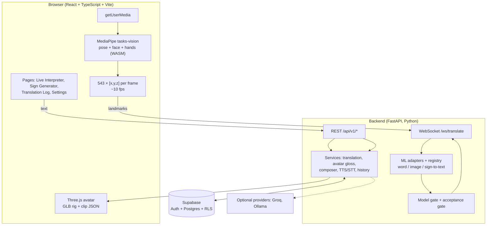

# SignSage — Architecture

How the system is built and the exact contracts between its parts.
Intended scope lives in the [PRD](PRD.md); datasets and models in [MODELS_AND_DATA](MODELS_AND_DATA.md); hosting in [DEPLOYMENT](DEPLOYMENT.md).
**Code and tests are authoritative.** Where this file and the code disagree, fix this file.

## 1. Principles

1. **Landmarks, not video.** On the live camera path, frames are processed in the browser and only coordinates travel. (An optional manual video-upload flow sends the chosen file; see [SECURITY.md](../SECURITY.md).)
2. **Honest refusal beats a confident guess.** A model gate and an acceptance gate sit between inference and the user.
3. **Deterministic where possible.** English → gloss is a vocabulary lookup; an optional LLM can only choose from that vocabulary.
4. **Research is separate from serving.** Notebooks and training scripts never run inside the app; the app never retrains.
5. **Contracts are pinned.** Landmark order, dimensions and versions are values to check, not just counts.

## 2. System overview

## 3. Components

| Part | Where | Responsibility |
|---|---|---|
| Frontend | `frontend/src/{app,features,services,components}` | Camera, landmark extraction (`features/translate/landmarks.ts`), WebSocket client, UI, avatar playback |
| Backend API | `backend/app/api/{routes,websocket}` | REST and WebSocket endpoints, request validation |
| Services | `backend/app/services` | Translation orchestration, avatar gloss, sentence composition, speech, history |
| ML | `backend/app/ml/{adapters,preprocessing,inference,models}` | Adapters per model type, preprocessing, decoding, registry (cached once per process) |
| Core | `backend/app/core` | Config, security (Supabase token check, TTL cache), rate limits, dependencies |
| Infrastructure | `backend/app/infrastructure` | Supabase REST client, repositories, SQL migrations, model storage |
| Research | `research/` | Notebooks, training, evaluation records — never imported by the backend |

## 4. Data flows

### 4.1 Live Sign → Text

1. The browser opens `/ws/translate`; the first message authenticates (JWT, or guest).
2. It sends one `landmarks` message per detected frame (~10 fps, 543 × 3).
3. The backend keeps a rolling window, preprocesses it, and runs the active adapter.
4. The **acceptance gate** returns text only if there is enough motion and confidence; otherwise a refusal reason.
5. Interim text (`final:false`) appears only after the same prediction repeats on two windows; a `sentence.boundary` from the user produces the final result (and optionally saves history).

Two recognition paths exist:

| Path | Input to the model | State |
|---|---|---|
| **Isolated words** (`word_v3`, FDMSE-ISL models) | 60-frame window → `sign_features_v3` → 60 × 122 hand-centric features → small neural classifier, top-3 | Experimental / in progress |
| **Continuous Sign → Text** (`SignToTextAdapter`) | 543 × 3 → `pose_normalize_v1` → 160 × 1629 → transformer → tokenizer | Gated off; no promotable model |

**Live word path for the FDMSE-ISL model (serving recipe).** "Record word" captures 3 s (about 25–30 frames at ~10 fps) or the auto-segmenter cuts one hands-present span; the frontend posts the frames plus the camera's `video_width` / `video_height` to `/translation/word`. The backend resamples to **exactly 48 frames** (`sign_features_v3` pads shorter input by repeating the last frame and its velocities are per frame step, so the model must see the 48-frame layout it was trained on), derives the face points from pose, multiplies x by the aspect ratio, runs `sign_features_v3`, standardises with the bundle's mean/std and applies the BiGRU. The result carries `aspect_source` (`client` or `assumed`). A golden-vector test pins these features to the training code.

### 4.2 Static image classification

`POST /api/v1/classification/image?task=alphabet` — a 64 × 64 RGB frame is classified into A–Z. Separate from the video paths; its result must not be used as evidence for them.

### 4.3 English → ISL

Text or microphone input → `POST /api/v1/text-to-sign` → deterministic mapping (optionally LLM-assisted, **filtered to the known vocabulary**) → gloss IDs → avatar clips in order. Unknown words are returned as dropped. Glosses without a clip render "No clip yet". See [SIGN_ANIMATION](SIGN_ANIMATION.md).

### 4.4 Sentence composition

Signed words → deterministic rules → (only if no rule matches) a constrained LLM → plain comma-join. The LLM may add only `is/are/am/the/a/i/can/could`, may reorder, and every signed word must appear exactly once; anything unverifiable falls back to the comma-join.

### 4.5 Speech

TTS: backend provider when configured, browser Web Speech as automatic fallback (`503 TTS_UNAVAILABLE` triggers the fallback). STT: browser Web Speech or a server endpoint. Keys stay server-side. Auto-speak plays completed interpretations only.

## 5. Contracts

### 5.1 Landmark representation

- 543 landmarks × 3 coordinates = **1629** floats per frame.
- Order (values, not just counts): POSE 33 (0–32; hips are 23/24) → FACE 468 (33–500) → LEFT_HAND 21 (501–521) → RIGHT_HAND 21 (522–542).
- Coordinates are MediaPipe image-space `x, y` plus relative `z`. Missing landmarks are `[0,0,0]`. The frontend never pre-normalises.
- The trailing world-pose block is excluded.
- Single source of truth: `landmark_contract.json` in a model bundle. Constants mirror in `backend/app/ml/preprocessing/landmarks.py` and `frontend/src/features/translate/landmarks.ts`.

### 5.2 Preprocessing

| Name | Used by | Definition |
|---|---|---|
| `pose_normalize_v1` | Continuous path | Hip-midpoint centring (fallback body mean), scale by median per-frame body-33 std, `nan_to_num → 0`. Must be numerically identical in training and serving |
| `sign_features_v3` | Isolated-word path (legacy) | `(60, 122)` hand-centric vector from `x, y` only. Hand identity by temporal nearest-wrist (MediaPipe Left/Right labels are **ignored**; the camera is unmirrored); the active hand is mirrored to one side. Reads four face-mesh points (nose, chin, mouth, forehead) |
| `sign_features_v4` | Isolated-word path (FDMSE-ISL models) | The same feature code (revision 2 handles **missed hands** robustly: active hand chosen from frames where it was seen; no phantom hand after mirroring; identical to v3 when nothing is missed) on **isotropic** coordinates (x × video width/height) with the four face points **derived from the pose head points** (nose; eye centres; mouth corners) because the face mesh was not detected in the training videos. Serving must apply the same `to_landmarks_543(..., face_source="pose", aspect=width/height)` recipe to the live frames (recorded in the exported `preprocessing.json`) |

### 5.3 Temporal convention (live)

Frontend sends only detected frames at ~10 fps (`SEND_INTERVAL_MS=100`). Backend: max 160 frames per sequence, live window 80 with stride 20, hard cap 640 (then `SequenceTooLongError` and reset). `prepare_live_landmarks` resamples to `(160, 1629)` and passes the true length for the padding mask; at least 2 frames are required.

### 5.4 WebSocket `/ws/translate` (unversioned)

| Direction | Message |
|---|---|
| → | `auth` (JWT) — first |
| → | `landmarks` with `frame.landmarks: 543 × [x,y,z]`, all finite |
| → | `sentence.boundary` (optional `save_history`) |
| ← | `translation.text { text, accepted, reason, confidence, result_type, history_id, final }` |
| ← | `error { code }` then close |

Error codes: `MODEL_UNAVAILABLE` (gate working as intended), `INVALID_MESSAGE` (also for NaN/±Inf), `SEQUENCE_TOO_LONG`. Message size is capped. The canonical schema is `backend/app/schemas/websocket.py`, mirrored in `frontend/src/services/websocket/protocol.ts` and checked by a contract test; **the schema wins over this text.**

### 5.5 REST (`/api/v1`)

| Endpoint | Purpose |
|---|---|
| `GET /health`, `/capabilities`, `/models` | Honest status: promotion, bundle found, loaded, available modes |
| `POST /translation/sign-to-text` | Continuous path; 503 `MODEL_NOT_PROMOTED` when gated (backend live; the frontend does not call it) |
| `POST /translation/word` | Isolated word: `word, confidence, accepted, top3, threshold, model_version, status` (needs the word mode enabled and a model directory) |
| `POST /translation/sentence`, `/translation/compose` | Words → English sentence; `method` is `llm` or `fallback`; compose can save history idempotently |
| `POST /classification/image?task=alphabet\|word` | Static image classifier (word task is unpromoted) |
| `POST /text-to-sign` | English → gloss IDs from the known vocabulary; never invents IDs |
| `POST /speech/speak`, `/speech/transcribe` | Server TTS and STT, rate-limited, optional |
| `GET /auth/me` | Current user or 401 |
| `GET/DELETE /history`, `GET/DELETE /history/{id}`, `POST /history/bulk-delete` | Per-user, session-based history; another user's id returns 404 |

> **To verify:** the frontend calls `apiClient.uploadVideo`; confirm the backend route (earlier notes mention `/translation/video` and `/translation/islim/*`), document it here and check its file handling against [SECURITY.md](../SECURITY.md).

### 5.6 Verdict vocabulary

Only honest outputs: `accepted: true` with text, or `accepted: false` with a reason in `insufficient_motion`, `low_model_confidence`, `empty_output` (plus `MODEL_UNAVAILABLE` at transport level). Empty text is never presentable. A valid response proves protocol correctness — never accuracy.

## 6. Model serving and the promotion gate

- Flags: `SIGNSAGE_MODEL_PROMOTED` (default false) and `SIGNSAGE_ALLOW_UNPROMOTED_DEV` (local only; never on Render).
- If not promoted and not allowed, every sign-to-text request is refused **before any model code runs**.
- A continuous-model **bundle** contains `checkpoint/`, `tokenizer/`, `landmark_contract.json`, `sign_to_text_deployment.json`. Loading cross-checks the checkpoint, contract and tokenizer ids. `backend/scripts/model_check.py` verifies load and that all-zero input is rejected.
- Weights are never in git or the image; they are fetched at start (see [DEPLOYMENT](DEPLOYMENT.md)).
- Promotion criteria: [MODELS_AND_DATA §6](MODELS_AND_DATA.md#6-promotion-gates).

## 7. Persistence and auth

- Supabase owns identity; FastAPI never issues tokens. The backend verifies tokens with Supabase (`/auth/v1/user`, short timeout, TTL cache; failure → 503).
- History is session-based: one interaction = one `translation_sessions` row, sentences in `translation_messages`. Rows are immutable (no update endpoint).
- The backend forwards the **user's** JWT to PostgREST, never a service key; row-level security enforces isolation (`migrations/001_*`, `002_*`).
- Guest mode is a first-class state. WebSocket tokens arrive in the first message (browsers cannot set WS headers).

## 8. Frontend structure

`app/` routing and shell · `features/translate` (live interpreter) · `features/text-to-sign` · `features/history`, `saved`, `settings`, `auth` · `services/{api,websocket,supabase}` · `components/` shared UI. Landmark extraction, the WebSocket protocol types and the avatar scene are the contract-bearing files. UI rules: [DESIGN_SYSTEM](DESIGN_SYSTEM.md).

## 9. Key decisions

| Decision | Why | Status |
|---|---|---|
| FastAPI | Native async and WebSocket | Adopted |
| React + TypeScript + Vite | Existing stack, responsive app | Adopted |
| Browser-side MediaPipe | Video stays local | Adopted |
| WebSocket for the live loop | Streaming suits landmarks better than per-frame HTTP | Adopted |
| Single-device scope | No relay complexity before the core loop works | Adopted |
| 543 image-space landmarks | Pose + face + hands, without the duplicated world block | Adopted |
| Split by `video_id` / by signer | Blocks leakage; signer split where metadata allows | Adopted |
| Constrained composer (rules → guarded LLM → join) | Signed words can never be invented | Adopted |
| Groq → Ollama → deterministic fallback for gloss | Graceful degradation | Adopted |
| Server TTS optional, browser fallback always | Keys never reach the browser; never hard-fails | Adopted |
| Avatar clips: JSON on a fixed MakeHuman GLB, retargeted from MediaPipe landmarks | Data-driven motion; honest labels until reviewed | Adopted (2026-11-17) |
| Notebooks separate from serving | Different lifecycles | Adopted |
| No raw-camera upload, no high-stakes use | Privacy by construction | Adopted |

Record any change of decision here, with the reason.

## 10. Known gaps

| ID | Gap | Fix |
|---|---|---|
| B1 | No promotable recognition model yet | FDMSE-ISL training and evaluation ([PRD §9](PRD.md#9-roadmap)) |
| B2 | Landmark order is trusted at load, never compared | Compare order/range values at bundle load; add a swapped-order rejection test |
| B3 | Confidence floor ships at `0.0` | Calibrate on held-out data with any promotion; add a wrong-input-must-reject test |
| B4 | No numeric normalisation-equivalence test | Shared golden-vector test between training export and backend |
| B6 | Frontend never calls the REST sign-to-text endpoint | Wire it behind the gates, or remove it |
| — | Browser vs training extractor parity only partly closed: the browser now loads the full pose model (as in training) but still runs in tracking (VIDEO) mode, training used per-image detection; webcam vs studio video is unmeasured; capture window (3 s) and the auto-segmenter's hands-present spans vs fixed 3 s training clips | Notebook 03 (live-like stress test on real test landmarks); a webcam test set is the only measure of the camera gap |
| — | The FDMSE-ISL model has no "no sign" class and gives about 50% confidence to a perfectly frozen pose; phrase mode (sliding 20-frame windows, drops `rest`) does not fit it | Motion floor (`metrics.json`), keep the confidence threshold, keep phrase mode off, consider a negative class |

## 11. Changing a contract

Any change to a value in §5 must update, **together**: the contract files, the code constants (backend and frontend), and the tests. Never create numbered copies of documents; edit this file.
