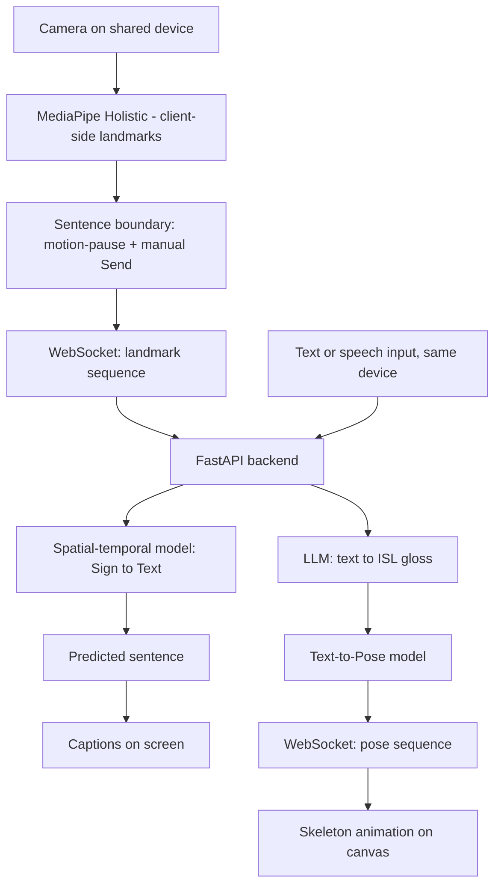

# SignSage — Architecture

## Current state (be honest about this)

As of this writing: **no standalone backend or frontend exists.** The primary artifact
is `notebooks/signsage.ipynb` (61 cells), which has been prepared and
statically validated — every code cell compiles, the notebook loads as valid `nbformat`
4.5 — but has **not yet been run end-to-end on the real iSign data inside Kaggle**. Do
not read "statically validated" as "experimentally validated"; the first real Kaggle
execution is still the source of truth, and runtime, data-format, and GPU-memory issues
found there are expected.

The earlier Phase-1/2 live-demo prototype (a FastAPI WebSocket server plus a MediaPipe
HTML/JS client, formerly Section 18 behind `RUN_LIVE_DEMO = False`) has been **removed
from the notebook entirely** — the research artifact no longer contains serving code. See
DECISIONS.md for why, and API.md / DESIGN.md for a record of how that spike diverged from
the contract, kept so the real backend doesn't repeat the same mistakes. Everything below
is the target MVP architecture, gated on the notebook producing a go decision (see
PHASES.md). Do not start building the standalone version until then.

## Training-time architecture (what actually runs today)

```text
HuggingFace: Exploration-Lab/iSign (gated)
  ├── iSign_v1.1.csv                      downloaded outright (9.81 MB)
  └── iSign-poses_v1.1_part_a{a,b,c,d}    NOT downloaded; opened as one virtual
                                          ZIP64 over HTTP range requests
        ↓
Kaggle Notebook (GPU T4, Internet enabled, HF_TOKEN secret)
  ├── lazy per-member .pose fetch  →  /kaggle/temp/signsage_cache/  (ephemeral)
  ├── preprocessing, normalization, face ablation
  ├── training (GRU, Transformer, pose generator)
  ├── evaluation (WER/BLEU/ROUGE-L, DTW, round-trip, latency)
  └── /kaggle/working/signsage_outputs/
        ├── checkpoints/
        ├── reports/
        ├── signsage_knowledge.db
        └── signsage_knowledge_manifest.json
        ↓
downloaded into this repo  →  Phase 1 backend loads the checkpoint for inference
```

The application never retrains. Training is a separate, offline, expensive step; the
backend loads a finished checkpoint and reads the knowledge repository only for
model/experiment metadata.

## Why single-device, not two-device relay

The original proposal's diagram shows Person A and Person B as separate clients relayed
through a FastAPI backend over WebSocket, with short-lived room codes for pairing. That
is a **deferred, post-MVP feature**, not the starting point, because:

- The primary use case (a Deaf person and a hearing person communicating without an
  interpreter) is overwhelmingly a same-room scenario — a reception desk, a classroom, a
  clinic. Think "Google Translate conversation mode passed between two people," not
  "two phones on a video call."
- A two-device relay adds session management, room-code generation/expiry, WebSocket
  reconnect handling, and NAT/deployment concerns — none of which test whether the
  underlying translation is any good.
- If real usage later demonstrates a genuine need for remote pairing, it's a bounded,
  well-understood addition on top of a working single-device core. Building it first is
  building infrastructure around an unproven model.

## MVP architecture (single device)



## Components

| Component | Responsibility | Runs where |
|---|---|---|
| Landmark extraction | MediaPipe Holistic (WASM), 543 landmarks (pose+hands+face) | Client (browser), privacy: raw video never leaves device |
| Sentence boundary detector | Tunable motion-pause heuristic + manual "Send" override | Client |
| Sign->Text model | Spatial-temporal model (starts as GRU baseline, upgrades to Transformer — see DECISIONS.md) | Backend, on a landmark sequence buffered for one sentence |
| Text->Gloss | LLM call (Groq primary, Ollama offline fallback) | Backend, calls external API |
| Text->Pose model | Generates a pose sequence from gloss/text | Backend |
| Skeleton renderer | Draws the predicted pose sequence | Client (canvas/SVG — no avatar) |
| Transport | WebSocket (landmark frames up, text/pose results down) | Client <-> Backend |

## Tricky integration points (known risks, in priority order)

1. **Train/inference landmark skew.** iSign ships pre-extracted `.pose` files from
   whatever pipeline the paper authors used offline. Live inference uses our own
   client-side MediaPipe JS extraction. These may not produce statistically similar
   landmarks. Check this early (compare distributions), not during final integration.
2. **Sentence-boundary tuning.** Motion-pause detection will either cut sentences short
   or merge separate thoughts. Needs real tuning against real signing, not just test
   clips recorded by one person.
3. **Latency budget stacking.** Client landmark extraction + network + model inference
   (buffered per-sentence, not per-frame) + LLM call + pose generation + render. This is
   inherently multi-second, not sub-second. Define an explicit target now (e.g., "under
   2-3s from end-of-signing to caption") rather than leaving "real-time" as a vague claim.
4. **Shared-device UX contention.** Who owns the mic/camera at any moment on one shared
   device, and how is turn-taking signaled without feeling clunky.

## Explicitly deferred (do not build until triggered)

| Feature | Trigger to revisit |
|---|---|
| Two-device WebSocket relay + room codes | Single-device MVP is validated and a real remote-communication need is demonstrated |
| GAT (graph attention) in the model | Plain Transformer baseline is trained and a specific accuracy gap points at needing explicit joint-relationship modeling |
| PWA packaging | Core translation loop works and is worth installing as an app |
| Turso / distributed persistence | SQLite genuinely becomes a bottleneck (unlikely pre-launch) |
| Photorealistic avatar | Out of scope for this project entirely (see PRD.md) |

## Tech stack

See DECISIONS.md for the reasoning behind each choice.

| Layer | Choice |
|---|---|
| Frontend | React + Vite (if already known) or plain JS/HTML/canvas (if React would be new) |
| Landmarks | MediaPipe Holistic, client-side (WASM), blendshapes preferred over raw face mesh once introduced |
| Backend | FastAPI (async, native WebSocket) |
| Model | GRU baseline first, Transformer encoder/decoder next (see PHASES.md) |
| LLM | Groq (primary, fast hosted inference), Ollama (offline/no-API-cost fallback) |
| Persistence | SQLite |
| Training | Kaggle Notebooks, GPU (T4), fp16 mixed precision — moved off local CPU-only training, which was too slow for the timeline, and off Google Colab before that; see DECISIONS.md |
| iSign dataset access (training) | Streamed from HuggingFace as a virtual multipart ZIP64 over HTTP range requests. Nothing uploaded to Kaggle, nothing extracted, only the 9.81 MB CSV downloaded. Requires Kaggle Internet + an `HF_TOKEN` secret; see SECURITY.md |
| iSign dataset storage (local fallback) | A separate dedicated machine holding the extracted ~231 GB archive (127,237 `.pose` files, confirmed). Reached via a Jupyter server on that machine from the dev laptop's VS Code over Tailscale — no network mount. Still supported via `SIGNSAGE_DATA_DIR`, but no longer the training path; see DECISIONS.md |
| Experiment tracking | SQLite (`signsage_knowledge.db`, 7 tables keyed on `run_id`) plus a portable JSON manifest, written by every run; see DATA_MODEL.md |
