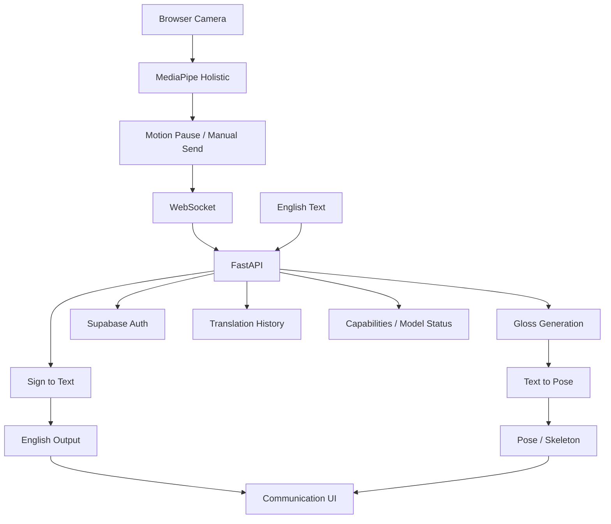

# SignSage — Architecture

**Status:** Current runtime architecture + research pipeline

## 1. Runtime architecture



## 2. Boundary between browser and backend

The browser owns:

- camera access,
- MediaPipe Holistic,
- landmark extraction,
- sentence-boundary interaction,
- communication UI,
- pose visualization.

The backend owns:

- translation orchestration,
- model inference,
- authentication verification,
- history operations,
- capability/model status,
- external LLM integration where enabled.

## 3. Privacy boundary

```text
camera frame
    ↓
MediaPipe in browser
    ↓
landmark vector
    ↓
WebSocket
    ↓
backend
```

Raw video is not part of the translation transport.

## 4. Research/training architecture

```text
iSign / research data
        ↓
Kaggle research notebook
        ↓
preprocessing + training
        ↓
evaluation + provenance
        ↓
research outputs
        ↓
checkpoint review
        ↓
model promotion decision
        ↓
backend inference
```

Training is separate from serving. The application does not retrain the model during normal use.

## 5. Important distinction

A research checkpoint can be:

```text
trained → saved → loadable → runnable
```

without being:

```text
validated → useful → generalizable → deployable
```

SignSage currently has evidence for the first group, while the research results document unresolved problems in the second group.

## 6. Key risks

### Landmark distribution skew

Training uses pre-extracted pose data while live inference uses browser MediaPipe output. Distribution compatibility must be checked rather than assumed.

### Sentence segmentation

Motion-pause detection can split one sentence incorrectly or merge multiple signs/sentences.

### Model collapse

The completed experiments show repeated/generic outputs in Sign→Text and weak motion in Text→Pose.

### Deployment resources

The documented deployment plan notes that free backend hosting may be insufficient for PyTorch/checkpoint workloads.

## 7. Deferred architecture

Two-device relay, room codes, and remote communication are intentionally outside the current single-device scope.
