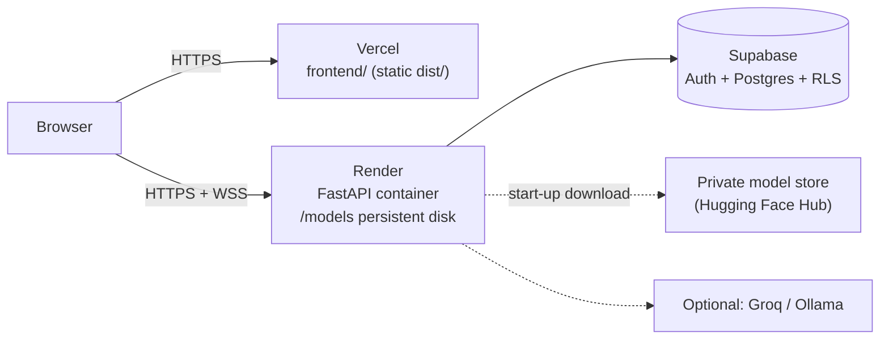

# SignSage — Deployment and Operations

Topology, environment variables, how a model bundle reaches production, and how to verify a deployment.
This describes the repository's configuration, not a live check of any dashboard.

## 1. Topology



| Piece | Platform | Notes |
|---|---|---|
| Frontend | Vercel (`frontend/`, `npm run build` → `dist/`) | Only public environment variables; set the backend URL |
| Backend | Render (`render.yaml`, Docker, context `backend/`) | 2 GB persistent disk at `/models`; start `bash scripts/fetch_bundle.sh && exec uvicorn app.main:app --host 0.0.0.0 --port $PORT`; health check `/api/v1/health` |
| Auth / history | Supabase | Postgres, JWT, per-user row-level security; migrations in `backend/app/infrastructure/database/migrations/` |
| Models | Private artifact store | Weights are **never** in git or baked into the image |

Free or small instances may not suit PyTorch, checkpoints and WebSockets: starting successfully is not the same as being production-grade.

**Runtime details (from the storage audit)**
- Container: `python:3.11-slim`, CPU-only PyTorch, non-root user, **no weights baked in**. `SIGNSAGE_DEVICE=cpu`, `SIGNSAGE_LOG_LEVEL=INFO` in the blueprint.
- Start-up loads a model only if the gate is open (`model_promoted` or the dev flag); a load failure is logged and **not fatal** — the service still starts and answers `/health` and `/capabilities`.
- `fetch_bundle.sh` downloads once (no resume), verifies the checksum when set, extracts, and checks the required entries. It skips the download when the target directory already looks complete.
- **Disk:** 2 GB holds one active bundle (a typical bundle is 200–700 MB as ZIP plus extracted files). Keeping a rollback copy of larger bundles can exceed it — raise the disk to 4 GB before retaining old versions. Datasets and pose caches never go on Render.
- The backend serves non-inference endpoints with no model bundle at all.

## 2. Environment variables

Set secrets in the platform's secret store, never in git, `render.yaml` or logs. Templates: `backend/.env.example`, `frontend/.env.example` (no real values).

| Variable | Purpose | Notes |
|---|---|---|
| `SIGNSAGE_MODEL_PROMOTED` | Production gate | **`false`** until a model passes [MODELS_AND_DATA §6](MODELS_AND_DATA.md#6-promotion-gates) |
| `SIGNSAGE_ALLOW_UNPROMOTED_DEV` | Local escape hatch | **Never set on Render** (absent from `render.yaml`) |
| `SIGNSAGE_MODEL_BUNDLE_DIR` | Continuous-model bundle directory | Use a **new path per release** |
| `SIGNSAGE_BUNDLE_URL`, `SIGNSAGE_BUNDLE_SHA256` | Where and what to download at start | URL pinned to an immutable revision; checksum always set |
| `SIGNSAGE_HF_TOKEN` | Read token for a private Hub repo | Secret |
| `SIGNSAGE_IMAGE_ALPHABET_BUNDLE_DIR`, `SIGNSAGE_IMAGE_WORD_BUNDLE_DIR` | Static image classifiers | Point to the verified bundles |
| `SIGNSAGE_WORD_MODE_ENABLED` | Enable isolated-word recognition | Needs a word model directory |
| `SIGNSAGE_FALLBACK_ENABLED` | Checkpoint-free heuristic | `false` restores strict refusal |
| `SIGNSAGE_GROQ_API_KEY` | Constrained composer and gloss mapper | Secret; optional |
| `SIGNSAGE_GROQ_TTS_API_KEY`, `SIGNSAGE_TTS_PROVIDER` (`auto\|groq\|browser`) | Server TTS | Secret; provider default to confirm in the TTS service |
| `SIGNSAGE_RATE_LIMIT_*` | Per-client limits (word, compose, history write, login, TTS) | Defaults in `core/config.py` |
| `SIGNSAGE_PIPER_CACHE`, `SIGNSAGE_DATASET_VERSION` | Local TTS voice cache; dataset manifest version | Optional |
| Supabase URL and anon key | Frontend and backend token checks | Public anon key only in the frontend |

CORS defaults to the local dev origin; set the production frontend origin explicitly. Security headers are set only in the backend (`security_headers_middleware`); do not duplicate them in the frontend host.

## 3. Shipping a model bundle

Keep artifacts in a **private, versioned** store; Render downloads the chosen bundle to `/models`. The store is the source of truth; the disk is a runtime copy. A private Hugging Face **Model** repository is suitable (not a Space).

1. **Choose an eligible model:** compatible with the adapter, passed the gates, redistribution rights cleared. Loading successfully is not eligibility.
2. **Validate locally:** `export SIGNSAGE_MODEL_BUNDLE_DIR=/abs/path/bundle && python -m scripts.model_check` (checks load and the zero-input rejection; does not prove quality).
3. **Package** with entries at the ZIP root — `checkpoint/`, `tokenizer/`, `landmark_contract.json`, `sign_to_text_deployment.json` (not nested in a folder):

   ```bash
   (cd "$BUNDLE_DIR" && zip -0 -r "$ZIP_PATH" *)
   unzip -l "$ZIP_PATH" | head -30
   sha256sum "$ZIP_PATH"
   ```
4. **Upload** to the private repo; copy the commit SHA and use the pinned URL
   `https://huggingface.co/USER/REPO/resolve/COMMIT_SHA/bundle-vN.zip?download=true`.
5. **Configure Render:** set `SIGNSAGE_BUNDLE_URL`, `SIGNSAGE_BUNDLE_SHA256`, a **new** `SIGNSAGE_MODEL_BUNDLE_DIR` (for example `/models/signsage_bundle_v2`) and `SIGNSAGE_HF_TOKEN` (private repos). Keep the old directory until the new release is verified.
6. **Deploy and verify** (§4).

Do not overwrite a bundle in place: start-up skips the download when the configured directory already looks complete, even if the URL or checksum changed. **Roll back** by restoring the previous three values. Download uses a 300-second timeout; with no URL the app still starts and reports `model_bundle_found:false`.

Isolated-word and image models use their own bundle directories (see §2) and follow the same rules: private store, pinned revision, checksum.

## 4. Verifying a deployment

```bash
curl -fsS https://YOUR-SERVICE.onrender.com/api/v1/health
curl -fsS https://YOUR-SERVICE.onrender.com/api/v1/capabilities
```

Check in order: frontend loads; sign-in works; health responds; WebSocket connects; payloads accepted; errors surface; history is isolated per account; capabilities report model state **honestly**. A healthy HTTP service does not mean inference is enabled or validated. Smoke tests never validate model quality.

## 5. Security notes

- Treat `.pt` / `.pth` files as trusted-code inputs (pickle). Deploy only from an access-controlled source and verify the checksum from a trusted channel.
- Never enable the unpromoted dev flag on a public service.
- Do not rehost third-party weights or datasets whose redistribution rights are unverified.
- Add a Supabase password policy in the dashboard — the client-side complexity rule is not a server guarantee.
- More: [SECURITY.md](../SECURITY.md).

## 6. Local development

See the README quick start. Use the Python version recorded in `pyproject.toml` (`>= 3.11`) and a Node version compatible with the frontend toolchain. Never replace a working `.env` with a template; keep `SIGNSAGE_MODEL_PROMOTED=false` unless the promotion process is complete and approved.
