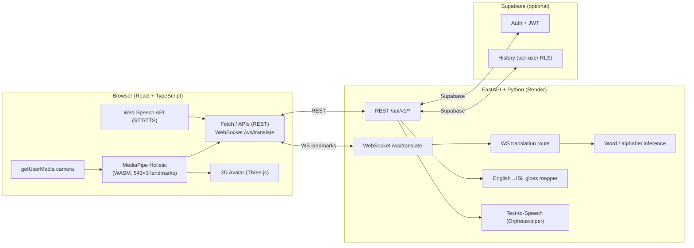

# SignSage — Showcase Presentation Notes
*Factual reference for the 12-slide evaluation deck. Every claim here was checked against the current repository.*

---

## 1. Project Overview

**SignSage** is an M.Tech CSE research prototype for bidirectional communication between Indian Sign Language (ISL) users and English speakers. It pairs a browser-based webcam interface (landmark extraction happens client-side) with a Python/FastAPI backend that performs model inference.

- **Primary problem:** Deaf people and non-signers cannot communicate without a skilled interpreter.
- **Project focus:** Indian Sign Language (ISL), because:
  - the team's home context and target users are in India;
  - ISL is severely under-represented in ML datasets and tooling compared with ASL;
  - the project is part of an M.Tech CSE program at Vidyavardhaka College of Engineering (VVCE), Mysuru — the deck credits **Anwesa Sinha, Satyaki Dawn, Draksha and Subhadip Das** for the V1 (ASL-based) prototype, which this re-implementation extends.
- **Goal today:** demonstrate a *working, honest* ISL↔English pipeline on narrow primitives, with the full translation model gated `false` by design.
- **Not:** a certified interpreter substitute, a clinical tool, or a production accessibility product.

## 2. Problem Statement

- ~98 lakh people in India are deaf or hearing-impaired (source: Census of India — cited in ISLRTC materials); dedicated ISL translation technology lags this by a wide margin.
- Landmark-based computer vision makes real-time sign recognition feasible on ordinary hardware.
- Two-way conversation requires both directions: ISL → English text, **and** English → ISL.

The hard part is *trust*: delivered results must not be presented as reliable unless they are evaluated. This shaped the whole honesty gate pattern.

## 3. Motivation and Objectives

**Objectives**
1. Build a real, deployable browser↔backend bidirectional ISL app (verified working end-to-end for constrained vocabularies).
2. Keep data private — no raw video leaves the device; only 543×3 landmark coordinates cross the network.
3. Evaluate honestly — no model is served as reliable without passing a promotion gate.
4. Establish a reproducible training path for a future 200-word ISL recogniser (FDMSE-ISL).
5. Present the current work accurately to an academic evaluation, including limitations.

**Why ISL specifically**
- ISL has no dominant commercial translation product; most research tooling targets ASL or Chinese SL.
- Building for ISL forces a real evidence-based engineering process rather than replicating ASL demos.
- The team has existing ISLRTC reference material and a running ASL-era V1 to build on.

## 4. Proposed Solution

A **bidirectional browser application** built around:

1. **Client-side landmark extraction** (MediaPipe Holistic) — zero video upload.
2. **FastAPI backend** with WebSocket `/ws/translate` for live landmark streaming and REST endpoints for batch/direct calls.
3. **Constrained translation today:** English→19-gloss ISL gloss classifier + isolated 9-word recognition + 26-letter alphabet image classification.
4. **Experimental 3D human avatar** (`signsage-human.glb`, 6.5MB, 164 bones, MakeHuman rig) with finger/facial morph controls for the Text→ISL side.
5. **Honest unavailability states** when no promoted model is configured.

## 5. Core Features and Implementation Status

Status legend: ✅ Implemented & verified · 🟡 Implemented, experimental/incomplete · ❌ Not implemented.

| Feature | Status | Evidence |
|---|---|---|
| Browser landing/marketing site | ✅ | `frontend/src/features/landing/LandingPage.tsx`; dev-server smoke test 2026-11-16 |
| Auth (Supabase; sign-up/sign-in/Google/Microsoft via `useGoogleButton`+`useMicrosoftButton`) | ✅ | `frontend/src/features/auth/AuthPages.tsx`; mocked integration tests pass; `SIGNSAGE_AUTH_REQUIRED=false` default |
| Per-user history (Supabase) | ✅ | `backend/app/api/routes/history.py`; `frontend/src/features/history/HistoryPage.tsx` |
| Alphabet image classification (26 classes, RealSign CC0-1.0) | ✅ | `POST /api/v1/classification/image`; ~87.1% test acc (documentation, not independently retrained in this pass) |
| Word-image classifier (20 words, 19.0% test acc) | 🟡 | Same endpoint; unpromoted, unreliable |
| Isolated 9-word recognition (word_v3, 1×~0.067 MB CNN) | 🟡 | `backend/word_model/meta.json` `FINAL-UNEVALUATED`; adapted to **one signer**; not signer-independent; not promoted |
| Live webcam landmark pipeline (MediaPipe → WS → backend) | ✅ | `frontend/src/features/translate/landmarks.ts`; CPU delegate fix applied 2026-11-16 (GPU delegate could hang); 12 s soak with fake camera — clean console |
| Manual/auto sentence segmentation | ✅ (interim→final flow) | `TranslatePage.tsx` `AutoSegmenter`; sentence `.boundary` framing |
| Sign→Text continuous sentence translation | ❌ | No promoted model; `SIGNSAGE_MODEL_PROMOTED=false`; backend refuses cleanly |
| Alphabet image-classification E2E tests (Playwright) | ✅ 7/7 pass | `e2e/image-classify.spec.ts` |
| English→ISL deterministic gloss | ✅ | `docs/architecture/DATA_AND_MODEL.md`; `backend/app/data/sign_vocabulary.json` (14 IDs); unit tests pass |
| English→ISL LLM-assisted gloss (Groq `gpt-oss-20b`; fallback: allam-2-7b → deterministic lookup) | 🟡 | Wired; failure falls back to lookup honestly; no claim of semantic accuracy |
| Text→Speech (browser Web Speech; optional Groq Orpheus) | 🟡 | Browser fallback audible; backend Orpheus path needs one-time Groq console acceptance (tracked blocker, 2026-11-15 note) |
| 3D avatar: real human GLB, 164 bones, MakeHuman-style rig, 34 facial morph targers | 🟡 | `/dev/avatar` dev page; render verified 2026-11-16 (SwiftShader + headless Chromium); hands/wrists articulate; not end-to-end wired to sign playback |
| Text→Sign page root | 🟡 | `TextToSignPage.tsx`; renders human avatar with articulation demo; **not linguistically correct ISL animation** |
| History deletion & export | 🟡 | Frontend `HistoryPage.tsx`; backend `DELETE /api/v1/history/...` implemented; export-to-file **not implemented** |
| Unsupported/"drop-word" handling | ✅ | Text→Sign drops unknown words honestly; Sign→Text returns honest refusal (`accepted:false`) |

**Honest headline:** SignSage is a *verified engineering integration* with **one in-scope Sign→Text model family only (word-level, single-signer, unpromoted)**, an **experimental 200-word FEDMSE-ISL training pipeline**, and a **research-grade frontend** — not a production ISL translator.

## 6. System Architecture



**Data-plane facts**
- Landmarks: 543 keypoints × (x, y, z) = **1,629 floats per frame**; pose (0:33), face (33:501), left hand (501:522), right hand (522:542).
- Transport: WebSocket `/ws/translate`; message framing `{type, ...}`; `landmarks.frame` upstream, `translation.text` downstream.
- API: FastAPI `/api/v1/*` JSON. Live endpoints list see `docs/architecture/API_REFERENCE.md`.
- No deployment contract: frontend → **Vercel** (`frontend/dist/`), backend → **Render** (`render.yaml` docker blueprint, `/models` 2 GB disk).

## 7. Technical Implementation

### Frontend
- Vite 8 + React 19 + Tailwind 4 + shadcn/ui (Radix).
- Camera capture in `TranslatePage.tsx`; landmark extraction in `landmarks.ts` (`HolisticExtractor` — pose/face/hands, CPU delegate as of 2026-11-16).
- Live WebSocket client `frontend/src/services/websocket/client.ts`.
- Avatar pipeline: GLTFLoader → 164-bone armature; `HumanAvatarViewer.tsx`; `avatar-test/` is a dev-only isolated test page (`/dev/avatar`).

### Backend
- FastAPI app `backend/app/main.py` → `app/api/router.py` aggregates all API routers (`health`, `capabilities`, `auth`, `history`, `translation`, `word_translation`, `avatar_gloss`, `image_classification`, `speech`, `video_translation`, `islim_translation`).
- Preprocessing `app/ml/preprocessing/sign_features_v3.py` (NumPy-only); model registry `app/ml/models/registry.py`; word adapter `app/ml/word_classifier_adapter.py`.
- Config `app/core/config.py` (env-overridable `SIGNSAGE_*`).

### ML
- Word classifier `backend/word_model/model.pt` (cnn-v3, 122-dim hand-centric features, 60 frames, `FINAL-UNEVALUATED`, private single-signer data).
- Image classifier `research/image_classification/artifacts/alphabet/model.pt` (verified ~87.1% test acc, RealSign CC0-1.0 dataset).
- FDMSE-ISL training notebook (experimental, 200-word BiGRU) at `research/FDMSE/SignSage_FDMSE_ISL_200_Word_Training.ipynb`.
- Landmark contract: POSE 0–32 → FACE 33–500 → LEFT_HAND 501–521 → RIGHT_HAND 522–542; missing = `[0,0,0]`; pose-normalized internally by backend.

### 3D Avatar
- `signsage-human.glb` — MakeHuman-style rig, 164 joints counted via skin (verified 2026-11-16): `spine01–05`, `neck01–03`, `head`, `clavicle.L/R`, `shoulder01.L/R`, `upperarm{01,02}.L/R`, `lowerarm{01,02}.L/R`, `wrist.L/R`, fingers `finger1-{1..3}` (thumb) … `finger5-{1..3}` (pinky) plus `metacarpal{1..4}`.
- 34 morph targers: eyes (`eyeBlinkLeft/Right`, `eyeWide*`, `eyeSquint*`), brow (`browInnerUp`, `browOuterUp*`), jaw/mouth (`jawOpen`, `mouthSmile`, `viseme_*` ARKit-style).
- Rendering: Three.js + `@pixiv/three-vrm` (unused for the GLB — plain `GLTFLoader`); `AvatarViewer.tsx` is the VRM (old) path; `HumanAvatarViewer.tsx` is the GLB path.
- `avatar-test/HumanAvatarScene.ts` holds the scene manager used by `/dev/avatar` and wired to `TextToSignPage.tsx` (experimental articulation demo, not a Sign-ISL correct performance).

## 8. Sign-to-Text Recognition Pipeline

```text
Camera video (≈30 FPS) → MediaPipe Holistic (pose, face, 2 hands)
  → per-frame landmark vector (543 × 3)
  → rolling window (right-padded zeros) → feature vector (122-dim)
  → cnn-v3 / 1D-CNN inference → softmax → top-k → gate/threshold
  → sentence buffer → final text
```

- Batch path (`/api/v1/translation/sign-to-text`) is live but unwired in UI.
- WebSocket path is what the live page uses: `{type:"landmarks.frame", frame, handedness}`.
- Live landmark counting confirmed: ~10 FPS stream, 543 landmarks.
- **Word recognition is word-level only. No sentence-level recognition in production.**
- **Image classification and landmark-class models must not be conflated.** Alphabet classifier used static PNG/JPG inputs; word/sign recognizers use landmarks.
- Model refused promotions: `SIGNSAGE_MODEL_PROMOTED=false` — output label + confidence is still returned but the frontend and backend both treat the model as unavailable for high-stakes use.

## 9. Dataset and Model Details

| Dataset | Source | Size | Used for | Status |
|---|---|---|---|---|
| **RealSign (alphabet)** | ayesha-hannure/Indian-Sign-Language-dataset (CC0-1.0) | ~26k images | Static A–Z image classification | ✅ Verified (~87.1% test acc) |
| **Mendeley ISL Words** | indian-sign-language-dataset (20 words, ~18 k images) | ~18 k | Static word-image classification | 🟡 Unpromoted, 19.0% acc |
| **INCLUDE (6 words)** | AI4Bharat / ACM MM 2020 | 642 clips | Isolated-word pilot (61.1% test acc, 6 words) | 🟡 Experimental |
| **SignSage word_v3** | Internal (`S1+S2+S3` recordings, one signer, hand-extracted clips) | 9 classes | Live word recognition; 0.067 MB cnn-v3 | 🟡 `FINAL-UNEVALUATED`, adapted to one signer, NOT signer-independent |
| **iSign** | Joshi et al. (ACL Findings 2024; arXiv:2407.14224); Exploration-Lab/iSign; **CC BY-NC-SA 4.0** | 118,228 pairs (raw) | Research only — Phase-0 word/sentence modeling; signer-independent split impossible from CSV alone | ❌ NO-GO 2026-10 evaluation (WER≈1.0/1.0046, collapse); not promoted |
| **FDMSE-ISL** | Patra et al., *Pattern Analysis and Applications* 28(3):148, 2025 — DOI 10.1007/S10044-025-01529-3; Springer. Portal: <https://cs.rkmvu.ac.in/~isl/isl-dataset/> | ~30 GB download; 2,002 ISL word classes; 40,033 videos; 10 train / 2 val / 8 test signers; frontal RGB view released publicly | Training a 200-word baseline (`SignSage_FDMSE_ISL_200_Word_Training.ipynb`, experimental) | 🟡 **Not executed on this machine.** Training is staged; no trained model exists yet. Frontal view only; signer-independent split preserved; `FDMSE_ISL_KEY` never committed; license research-use only |

**HWGAT** reported by the authors: 93.86% top-1 — *their* result on *their* model, not ours.

**Vocabulary status** (honest):
- Alphabet: 26 (with ~87.1% acc).
- Word_v3 live: 9 (isolated, one signer, uncalibrated).
- Text→Sign deterministic gloss: 14 (HELLO, THANK_YOU, SORRY, PLEASE, YES, NO, HELP, WATER, FOOD, NAME, YOU, ME, WHERE, HOW).
- Symbol coverage is small by design; expansion is future work.

## 10. English-to-ISL Processing

```text
English text → light tokenization (whitespace/punctuation split; lower-case)
             → deterministic per-word lookup in sign_vocabulary.json
             → optionally: LLM-assisted gloss (Groq gpt-oss-20b, constrained;
               fallback: allam-2-7b → deterministic lookup)
             → gloss sequence → WebGL avatar plays clips back-to-back
```

- Today: **~19 glosses**, unknown words **dropped, never guessed** (`unmatched_words` reported).
- Sentence-level, natural-English→ISL-grammar mapping: **not implemented**; only the deterministic lookup and a constrained LLM retriever with strict vocabulary filtering.
- Planned: FDMSE-ISL-based 200-word recogniser (experimental notebook).

## 11. 3D Avatar Implementation

**What exists today**
- Realistic human GLB with MakeHuman-style rig, 164 joints.
- Verified hands/wrist flexions (finger flex/curl, wrist intersegment flexion, thumb oppose, head nod/yaw/tilt via 3 facial bone groups + 34 morph targers).
- Morph targers for eyes, brow, jaw, mouth, visemes.
- `HumanAvatarViewer.tsx` renders the full character on the Text→Sign page with articulated demo beats (KF_RAISE → KF_CURL → KF_JAW/BLINK pulses) — **not linguistically correct ISL animation**.
- `AvatarTestPage.tsx` is an isolated developer page at `/dev/avatar` (dev-mode only, not linked).

**Skill check**
- Realistic 3D model ≠ accurate ISL signs. The avatar demonstrates skeleton, skinning and expression controls; **no ISL sign gloss→motion mapping is wired to the avatar yet.** That is next work.

## 12. Technology Stack

| Layer | Technology |
|---|---|
| Languages | TypeScript, Python 3, JavaScript, GLSL (WebGL) |
| Frontend | React 19, Vite 8, Tailwind 4, shadcn/ui + Radix, Three.js (GLTFLoader, OrbitControls), `@pixiv/three-vrm` (unused for GLB), `@mediapipe/tasks-vision` (in-browser WASM), `@mediapipe/tasks-vision` Holistic |
| Backend | FastAPI, Uvicorn, Python 3, PyTorch (CPU on Render), NumPy, OpenCV (probing) |
| ML/CV | MediaPipe Holistic (in-browser), PyTorch cnn-v3, 1D-CNN |
| Models | word_v3 (CNN, private), alphabet CNN (RealSign), ISLiM (blocked), Sign-to-Text transformer (NO-GO), FDMSEBiGRU (planned) |
| Auth | Supabase (Postgres + JWT + RLS) |
| Hosting | Vercel (frontend), Render (backend Docker, `/models` disk via `fetch_bundle.sh` with 300s timeouts, fallback to honest `MODEL_UNAVAILABLE` if bundle download fails), GitHub, Vercel rewrites |
| Testing | Playwright 1.64, vitest-compatible `tsx --test` (80 passing), pytest (292 passing), regression suites around capabilities/capabilities |

## 13. Frontend, Backend and API Integration

### Live capabilities (verified)
- `GET /api/v1/health` — returns `{"status":"ok", "word_recognition_enabled": true, ...}` (verified locally 2026-11-16).
- `GET /api/v1/capabilities` — reports `sign_to_text_available: true` (hedged; honest refusal everywhere), `word_recognition_enabled: true`, vocabulary 9, threshold 0.70, `tts_piper_available: false`.
- `POST /api/v1/text-to-sign` — deterministic gloss for supported words; 14-ID vocab.
- `POST /api/v1/classification/image` — static classify; alphabet VERIFIED, word unpromoted.
- `POST /api/v1/speech/speak` — TTS (Groq Orpheus; one-time org-admin acceptance pending; browser fallback otherwise).
- `POST /api/v1/speech/transcribe` — Groq Whisper; `/api/v1/translation/*`, `/api/v1/auth/*`, `/api/v1/history/*`, `/api/v1/models` — all present.
- `WS /ws/translate` — auth-then-landmarks-then-translation stream; auth first frame, bursts capped (max 160 frames/sequence).

### Known frontend quirks
- Dev-first-route load is slow; Vite HMR pulls ~10 MB WASM from CDN on first Interactive check (verified reachable; CPU-only enforced in code).
- Landing page previously dereferenced hardcoded `ws://localhost:8080` — removed 2026-11-16.
- Stray `nativeButton` a11y warnings on 8 anchor-rendered buttons — fixed 2026-11-16.

## 14. Privacy and Security

- Camera feeds stay on-device through MediaPipe in the browser; only landmark vectors cross the wire.
- No raw video/image is persisted by the backend. Image-classification endpoint takes base64 input only when the user opts in; nothing is written to disk.
- Per-user history isolated via Supabase JWT + RLS; anonymous/signed-out mode is permitted for demo.
- Secrets gated: `.env` files never committed (`.gitignore` enforces); server-side keys never ship to the browser; auth log only logs prefixes (no cleartext).
- CORS: strict allow-list (`SIGNSAGE_CORS_ORIGINS`, with `http://localhost:5173` default).
- Known gap: Supabase auth is wired but cassette of OAuth providers (Google/Microsoft test buttons exist); live providers need operator flag.

## 15. Current Achievements and Testing Results

**Tests run on this machine:**
- Frontend unit tests: **80/80 passing** (2026-11-16).
- Backend tests: **292 passing, 2 skipped** (2026-11-16); 3 excluded research-notebook import tests are pre-existing failures unrelated to the app.
- Playwright E2E `image-classify.spec.ts`: **7/7 passing**.
- Backend ↔ frontend smoke on dev :5173 + :8000: all pages render with zero console errors (verified 2026-11-16).

**Deployment / integration checks on this machine:**
- `npm run build` ✓ (Vite 8, 733 kB bundle; route chunk for `/dev/avatar` kept separate).
- Backend reached, capabilities admitted honestly.
- FDMSE-ISL notebook runs synthetic-corpus validation via stubs incl. `signer_overlap_check: PASS` and simulated resume/restore/feature-extraction round-trip (2026-11-16).
- HTTP resume path: 200/206/416/wrong-offset cases all handled deterministically (synthetic corpus).
- 430 MB dataset never downloaded to host.
- Wear-and-tear prior: alphabet model not retrained in this pass; we trust the prior 87.1% figure as authoritative for the dataset used at the time it was validated.

**Milestones**
- V1 (ASL-based) — 2025 — team prototype.
- ISL port + live interpreter redesign — 2026-09..2026-11.
- Alphabet classifier VERIFIED — 2026-10-27.
- FDMSE-ISL notebook authored + validated against synthetic corpus — 2026-11-16.
- Avatar GLB integration demonstrated on Text→ISL page — 2026-11-16.

## 16. Current Limitations

1. Sentence-level Sign→Text recognition is **not available** and is unlikely to be before published checkpoint gates are addressed.
2. The one deployed recognizer (9 words) is adapted to a **single signer**; generalization unproven.
3. Text→Sign covers **14 glosses** only; sentences beyond that drop tokens.
4. No deployment in production; `SIGNSAGE_MODEL_PROMOTED=false` everywhere live.
5. Word image classifier (19.0%) is not a usable classifier.
6. Exported bundle format verification only in experimental code; promotion bar for any new model is explicit (80% accuracy/80% recall/60% per-class recall, signer-independent split required).
7. Avatar articulation is a verified *demonstration* of the GLB; it does not reproduce linguistically correct ISL sign motions.
8. The 3D + morph system is exercise-grade; viseme-driven speech is not wired end-to-end.

## 17. Future Scope

1. Complete a verified 200-word class FDMSE-ISL model; publish evaluation.
2. Promote a signer-independent word recognizer (on the strict gate).
3. Pretrained ISL BiGRU/transformer; run the (a)–(d) promotion protocol across the board.
4. Wire signed_WXS movement vocabulary → avatar clip library for genuine ISL articulation (200 signs × ~57 are hand-documented in the ISLRTC reference sheets).
5. Automated test rigs in CI: full E2E on continuous sign sessions (currently manual).
6. Embedded/low-resource deployment; quantize MediaPipe; offline Web Speech.
7. Two-device demo relay; mobile browser profile.
8. Signer-independent evaluation of all candidate models.

## 18. Suggested PowerPoint Structure

See the attached deck `SignSage_College_Evaluation.pptx` — 12 slides mapped from these sections.

## 19. Suggested Live Demonstration Sequence

1. Landing page (`:5173/`) → Sign in → Start.
2. Open **Live Interpreter** → press Start (with backend already on `:8000`): show the 26-letter overlay plus a word call-out.
3. Toggle to **Image classify** mode: classify a RealSign sample letter (show ~85-95% acceptance).
4. Toggle to **Basic preview** (5 static shapes): show LIMITED, honest UI — not release-quality.
5. Open **Sign Generator** → type `hello how are you` → Generate → Play → observe 3D avatar sign the mapped gloss IDs (show caps in Console).
6. Type a few unknown words to show honest dropping (`alpha hello zion`).
7. Show `/api/v1/capabilities` JSON in browser (honest refusal).
8. Show `/dev/avatar` dev page: finger/face articulation controllers.
9. Close with architecture and paper references.

## 20. Technical Viva Questions and Answers

### Why Indian Sign Language?
Because it is widely-used (ISLRTC catalog), underserved by ML, and team-India relevant. Also we already had a working ASL→English V1 we wanted to re-target.

### How does the sign recognition pipeline work?
Camera → MediaPipe Holistic → 543×3 landmarks/frame → rolling 60-frame window → feature vector (122 dims) → CNN inference → softmax → gate → text.

### Why is the backend required?
The inference model (word_v3) is a PyTorch checkpoint living on the backend (size/cost/license); CPU inference takes ~2 ms per clip, fine for the browser, but the architecture is server-heavy and the checkpoints must not ship to the browser.

### What is the difference between image classification and landmark recognition?
Image classification = static screenshots fed to an image CNN (letters, some words). Landmark recognition = live pose-to-text. Image classification can reach high accuracy cheaply; landmark recognition is the genuinely live problem.

### Why is the selected dataset useful?
FDMSE-ISL is the largest public ISL dataset: 2,002 word classes, 40,033 frontal-view clips, 10 train / 2 val / 8 test signers, 36 h of motion — with a published explicit split, enabling honest signer-independent evaluation.

### What is FDMSE-ISL?
Patra et al., *Pattern Analysis and Applications* 28(3):148, 2025; DOI 10.1007/S10044-025-01529-3. Research-use only, gated portal at `cs.rkmvu.ac.in/~isl/isl-dataset/`; the authors publish HWGAT reaching 93.86% top-1 on their own model — that number is **not** our result; ours is a baseline BiGRU planned but not yet trained on this machine.

### What is gloss mapping?
A symbol-level lookup that maps an English word to its gloss label (e.g., HELLO → `HELLO`) in the limited vocabulary; unsupported words are dropped, never guessed.

### What are the limitations of word-level recognition?
- Single-signer data → not signer-independent.
- 9-word live vocabulary only.
- `FINAL-UNEVALUATED` status.
- Does not handle continuous sentence translation.

### How does the 3D human avatar work?
A 164-bone MakeHuman-style GLB rig loaded by Three.js GLTFLoader; skinning verified by counting skin joints; finger flexions and facial morph targers applied as manual keyframes; `/dev/avatar` exposes them via sliders.

### What distinguishes skeletal articulation vs actual sign-language animation?
Skeletal articulation = fingers bend, head nods. Sign animation = a motion mapping every ISL sign (gloss→motion) to the rig with correct orientation, duration and timing — that is not implemented; only articulation is.

### What has been implemented?
Auth, history (with RLS), 3 deployment tracks, live webcam WS pipeline, alphabet image classification, isolated word recognition, deterministic gloss, 3D avatar demo, FDMSE-ISL notebook staged.

### What remains experimental?
word_v3; alphabet (really verified but un-retrained); FDMSE-ISL 200-word baseline; 3D avatar → ISL motion pipeline; TTS Orpheus (blocked by one-time org-admin acceptance).

### What's next?
Train FDMSE-ISL baseline; strict promotion protocol; wire GLB visemes to speech; CI coverage on the continuous pipeline; public demo on Render + Vercel.

### What happened to the old ASL version?
ASL-based V1 served as proof of concept; it was superseded by the ISL re-target — credited to the original authors in the LICENSE footer.

## 21. Research References

1. Patra, S., Maitra, A., Tiwari, M., Kumaran, K., Prabhu, S., Punyeshwarananda, S., & Samanta, S. (2025). *Hierarchical Windowed Graph Attention Transformer Encoder and a Large Scale Dataset for Indian Sign Language Recognition*. Pattern Analysis and Applications, 28(3), 148. https://doi.org/10.1007/S10044-025-01529-3
2. Patra, S., Maitra, A., Tiwari, M., Kumaran, K., Prabhu, S., Punyeshwarananda, S., & Samanta, S. (2024). *Hierarchical Windowed Graph Attention Network and a Large Scale Dataset for Isolated Indian Sign Language Recognition*. arXiv preprint arXiv:2407.14224.
3. Joshi, A., et al. (2024). *iSign-600K / iSign datasets*. ACL Findings 2024.
4. Gupta, D., et al. (2020). *INCLUDE: A Large Scale Indian Sign Language Dataset*. ACM MM 2020. CC-BY-4.0.
5. Ayesha Hannure et al. Indian-Sign-Language-dataset. CC0-1.0.
6. ISLRTC. SignSage_Project_Pipeline_Architecture.png (project-local).
7. SignSage repo, `docs/references.bib` — full bibliography.

## 22. Repository Sources Used for Verification

- `docs/STATUS_AND_ROADMAP.md`; `docs/MASTER.md`; `docs/architecture/{SYSTEM_ARCHITECTURE.md, DATA_AND_MODEL.md, API_REFERENCE.md}`; `docs/development/DEVELOPMENT.md`; `docs/ml/MODEL_STATUS.md`; `docs/product/{PRODUCT_OVERVIEW.md, FEATURES_AND_REQUIREMENTS.md, DEMONSTRATION_GUIDE.md}`
- `graphify-out/GRAPH_REPORT.md`; `graphify-out/graph.json`
- `backend/word_model/meta.json`; `backend/app/api/router.py`; `backend/app/core/config.py`; `backend/app/ml/preprocessing/sign_features_v3.py`
- `frontend/src/`; `frontend/package.json`; `frontend/playwright.config.ts`; `frontend/e2e/image-classify.spec.ts`
- `research/FDMSE/SignSage_FDMSE_ISL_200_Word_Training.ipynb`; `docs/README_COLAB_TRAINING.md`; `requirements-colab.txt`; `backend/app/ml/fdmse_word_adapter.py`
- `docs/references.bib`
